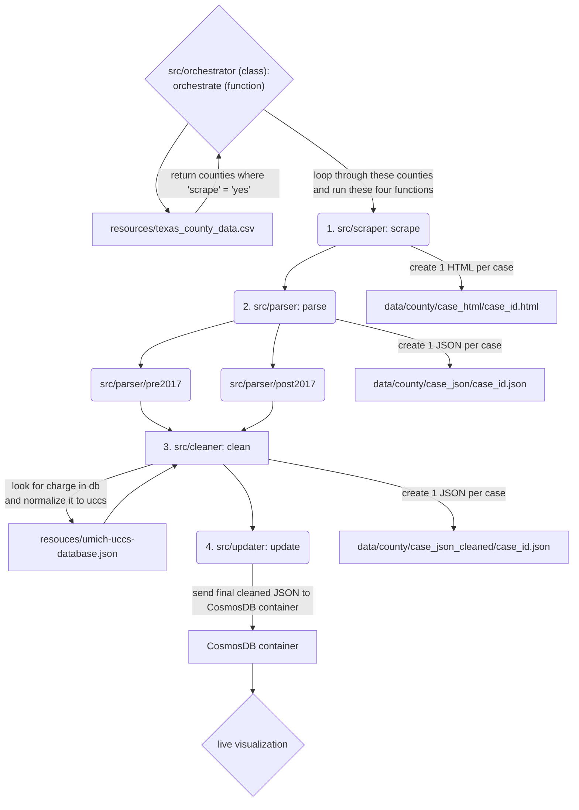

# Tyler Technologies Odyssey scraper and parser

This is a scraper to collect and process public case records from the Tyler Technologies Odyssey court records system. If you are a dev or want to file an Issue, please read [CONTRIBUTING](CONTRIBUTING.md).

## Local setup

### Install toolchain

1. Clone this repo and navigate to it.
   - `git clone https://github.com/open-austin/indigent-defense-stats`
   - `cd indigent-defense-stats`
2. Install Pyenv if not already installed ([linux, mac](https://github.com/pyenv/pyenv), or [windows](https://github.com/pyenv-win/pyenv-win))
3. Run `pyenv install` to get the right Python version

### Setup `venv`

First, you'll need to create a virtual environment, this differs depending on your OS.

On linux/mac

```bash
python -m venv .venv --prompt ids # (you can substitute `ids` for any name you want)
```

On Windows

```powershell
c:\>Python35\python -m venv c:\path\to\repo\ids # (you can substitute `ids` for any name you want)
```

Next, you'll need to "activate" the venv. You'll need to run this command every time you work in the codebase and tell your IDE which Python environment to use. It will likely default to wherever `python` resolves to in your system path. The specific command you run will depend on both your OS and shell.

On linux/mac

| platform | shell      | Command to activate virtual environment |
| :------- | :--------- | :-------------------------------------- |
| POSIX    | bash/zsh   | $ source <venv>/bin/activate            |
|          | fish       | $ source <venv>/bin/activate.fish       |
|          | csh/tcsh   | $ source <venv>/bin/activate.csh        |
|          | PowerShell | $ <venv>/bin/Activate.ps1               |
| Windows  | cmd.exe    | C:\> <venv>\Scripts\activate.bat        |
|          | PowerShell | PS C:\> <venv>\Scripts\Activate.ps1     |

Source: https://docs.python.org/3/library/venv.html#how-venvs-work

Note: Again, you'll need to activate venv _every time you want to work in the codebase_.

If the above doesn't work, try these instructions for creating and activating a virtual environment:
1. Navigate to your project directory: cd [insert file path]
2. Create a virtual environenment: python -m venv venv
3. Activate the virtual environment: .\venv\Scripts\activate.bat

### Install python dependencies

Using `pip`, install the project dependencies.

```shell
pip install -r requirements.txt
```

### Running CLI

@TODO - this section needs to be updated.

7. Set parameters to the main command:
   - counties = The counties that are listed in the count CSV. Update column "scraper" in the CSV to "yes" to include the county.
   - start_date = The first date you want to scrape for case data. Update in scraper.
   - end_date = The last date you want to scrape for case data. Update in scraper.
8. Run the handler.
   - `python run python .src/orchestrator`

## Structure of Code

- County Database: A CSV table contains the necessary Odyssey links and version for each county in Texas. One column ("scrape") indicates whether that county should be scraped. Currently, Hays is the default.
- Handler (src/handler): This reads the CSV for the counties to be scraped and runs the following processes for each county. You can also set the start and end date of the parser here.

  - **Scraper** (`src/scraper`): This scrapes all of the judicial officers for each day within the period set in the handler and saves all of the HTML to data/[county name]/case_html.
  - **Parser** (`src/parser`): This parses all of the HTML in the county-specific HTML folder to accompanying JSON files in data/[county name]/case_json.
  - **Cleaner** (`src/cleaner`): This cleans and redacts information in in the county-specific json folder to a new folder of JSON files in data/[county name]/case_json_cleaned.
  - **Updater** (`src/updater`): This pushed the cleaned and redacted JSON in the county-specific cleaned json folder to a container in CosmosDB where it can then be use for visualization.

## Flowchart: Relationships Between Functions and Directories


import sqlite3
from datetime import datetime
from pathlib import Path

from reportlab.lib import colors
from reportlab.lib.pagesizes import letter
from reportlab.lib.styles import ParagraphStyle, getSampleStyleSheet
from reportlab.pdfgen import canvas
from reportlab.platypus import (
    HRFlowable,
    KeepTogether,
    Paragraph,
    SimpleDocTemplate,
    Spacer,
    Table,
    TableStyle,
)


class NumberedCanvas(canvas.Canvas):
    """Two-pass canvas subclass to dynamically compute total page counts,
    footers, and top/bottom rules.
    """

    def __init__(self, *args, **kwargs):
        super().__init__(*args, **kwargs)
        self._saved_page_states = []

    def showPage(self):
        self._saved_page_states.append(dict(self.__dict__))
        self._startPage()

    def save(self):
        num_pages = len(self._saved_page_states)
        for state in self._saved_page_states:
            self.__dict__.update(state)
            self.draw_page_decorations(num_pages)
            super().showPage()
        super().save()

    def draw_page_decorations(self, page_count: int):
        self.saveState()
        self.setFont("Helvetica", 8)
        self.setFillColor(colors.HexColor("#4A5568"))

        # Footer title and dynamic page count
        footer_text = (
            f"Sullivan County Clerk Ledger Audit Memorandum  |  Page"
            f" {self._pageNumber} of {page_count}"
        )
        self.drawString(36, 25, footer_text)

        # Right-aligned timestamp
        now_str = datetime.now().strftime("%Y-%m-%d %H:%M:%S EST")
        self.drawRightString(576, 25, f"Generated: {now_str}")

        # Subtle bottom accent rule
        self.setStrokeColor(colors.HexColor("#CBD5E0"))
        self.setLineWidth(0.5)
        self.line(36, 36, 576, 36)
        self.restoreState()


def generate_chronology_pdf(
    db_path: str = "sullivan_clerk_ledger.db",
    output_pdf_path: str = "Sullivan_Clerk_Chronology_Memorandum.pdf",
) -> None:
    """Queries v_chronological_clerk_ledger from SQLite and builds a court-ready
    PDF memorandum.
    """
    db_file = Path(db_path)
    if not db_file.exists():
        raise FileNotFoundError(f"Database file not found: {db_path}")

    # 1. Fetch records from SQLite View
    with sqlite3.connect(db_file) as conn:
        cursor = conn.cursor()
        cursor.execute(
            "SELECT * FROM v_chronological_clerk_ledger ORDER BY item_number ASC;"
        )
        rows = cursor.fetchall()

    # 2. Page Setup (Letter size, 0.5 in / 36 pt margins -> 540 pt printable width)
    doc = SimpleDocTemplate(
        output_pdf_path,
        pagesize=letter,
        leftMargin=36,
        rightMargin=36,
        topMargin=40,
        bottomMargin=50,
    )

    styles = getSampleStyleSheet()

    # 3. Typography & Styling Rules
    court_header_style = ParagraphStyle(
        "CourtHeader",
        parent=styles["Normal"],
        fontName="Helvetica-Bold",
        fontSize=11,
        leading=14,
        alignment=1,  # Center
        textColor=colors.HexColor("#1A365D"),
    )

    sub_header_style = ParagraphStyle(
        "SubHeader",
        parent=styles["Normal"],
        fontName="Helvetica-Bold",
        fontSize=9,
        leading=12,
        alignment=1,
        textColor=colors.HexColor("#2B6CB0"),
    )

    doc_title_style = ParagraphStyle(
        "DocTitle",
        parent=styles["Normal"],
        fontName="Helvetica-Bold",
        fontSize=13,
        leading=16,
        alignment=1,
        textColor=colors.HexColor("#0F172A"),
        spaceAfter=12,
    )

    meta_label_style = ParagraphStyle(
        "MetaLabel",
        parent=styles["Normal"],
        fontName="Helvetica-Bold",
        fontSize=9,
        leading=13,
        textColor=colors.HexColor("#1E293B"),
    )

    meta_val_style = ParagraphStyle(
        "MetaVal",
        parent=styles["Normal"],
        fontName="Helvetica",
        fontSize=9,
        leading=13,
        textColor=colors.HexColor("#334155"),
    )

    section_heading = ParagraphStyle(
        "SectionHeading",
        parent=styles["Normal"],
        fontName="Helvetica-Bold",
        fontSize=10,
        leading=14,
        textColor=colors.HexColor("#1E3A8A"),
        spaceBefore=10,
        spaceAfter=4,
    )

    body_text = ParagraphStyle(
        "BodyText",
        parent=styles["Normal"],
        fontName="Helvetica",
        fontSize=8.5,
        leading=12,
        textColor=colors.HexColor("#1E293B"),
    )

    table_header_style = ParagraphStyle(
        "TableHeader",
        parent=styles["Normal"],
        fontName="Helvetica-Bold",
        fontSize=7.5,
        leading=9,
        alignment=1,
        textColor=colors.white,
    )

    table_cell_style = ParagraphStyle(
        "TableCell",
        parent=styles["Normal"],
        fontName="Helvetica",
        fontSize=7.5,
        leading=9,
        textColor=colors.HexColor("#0F172A"),
    )

    table_cell_center = ParagraphStyle(
        "TableCellCenter",
        parent=table_cell_style,
        alignment=1,
    )

    hash_style = ParagraphStyle(
        "HashStyle",
        parent=styles["Normal"],
        fontName="Courier",
        fontSize=6,
        leading=7.5,
        textColor=colors.HexColor("#0F172A"),
    )

    elements = []

    # --- Official Court Header Banner ---
    elements.append(
        Paragraph("IN THE SULLIVAN COUNTY COURTS", court_header_style)
    )
    elements.append(
        Paragraph("STATE OF INDIANA, COUNTY OF SULLIVAN", sub_header_style)
    )
    elements.append(Spacer(1, 8))
    elements.append(
        HRFlowable(
            width="100%",
            thickness=1.5,
            color=colors.HexColor("#1E3A8A"),
            spaceAfter=10,
        )
    )

    # --- Document Title ---
    elements.append(
        Paragraph(
            "NOTICE OF FILING AND CHRONOLOGICAL RECORD AUDIT LEDGER",
            doc_title_style,
        )
    )

    # --- Memorandum Header Block ---
    meta_data = [
        [
            Paragraph("TO:", meta_label_style),
            Paragraph(
                "Clerk of the Sullivan Circuit and Superior Courts",
                meta_val_style,
            ),
        ],
        [
            Paragraph("FROM:", meta_label_style),
            Paragraph(
                "Joshua Ryan Boone (Filing Party / Record Administrator)",
                meta_val_style,
            ),
        ],
        [
            Paragraph("DATE:", meta_label_style),
            Paragraph("October 14, 2026", meta_val_style),
        ],
        [
            Paragraph("SUBJECT:", meta_label_style),
            Paragraph(
                "Chronological Submission of Filings, Cryptographic Integrity"
                " Ledger, and Access to Court Records Rule 5 Compliance",
                meta_val_style,
            ),
        ],
    ]

    meta_table = Table(meta_data, colWidths=[65, 475])
    meta_table.setStyle(
        TableStyle([
            ("VALIGN", (0, 0), (-1, -1), "TOP"),
            ("BOTTOMPADDING", (0, 0), (-1, -1), 3),
            ("TOPPADDING", (0, 0), (-1, -1), 3),
            ("LEFTPADDING", (0, 0), (-1, -1), 0),
            ("RIGHTPADDING", (0, 0), (-1, -1), 0),
        ])
    )
    elements.append(meta_table)
    elements.append(Spacer(1, 8))
    elements.append(
        HRFlowable(
            width="100%",
            thickness=0.5,
            color=colors.HexColor("#94A3B8"),
            spaceAfter=10,
        )
    )

    # --- Section I: Chronological Table ---
    elements.append(
        Paragraph("I. CHRONOLOGICAL RECORD OF FILINGS", section_heading)
    )
    elements.append(
        Paragraph(
            "The following filings and court records are formally tendered for"
            " inclusion in the Chronological Case Summary (CCS) and official"
            " court record. Each file has been assigned a unique cryptographic"
            " SHA-256 checksum at the time of ingest to establish chain of"
            " custody, document authenticity, and temporal verification.",
            body_text,
        )
    )
    elements.append(Spacer(1, 8))

    # Total Column Width = 26 + 74 + 82 + 138 + 120 + 100 = 540 pt
    col_widths = [26, 74, 82, 138, 120, 100]

    headers = [
        Paragraph("Item", table_header_style),
        Paragraph("Ingest Time (UTC)", table_header_style),
        Paragraph("Cause Number", table_header_style),
        Paragraph("Document Description", table_header_style),
        Paragraph("Cryptographic Hash (SHA-256)", table_header_style),
        Paragraph("Access Rule Status", table_header_style),
    ]

    table_rows = [headers]

    for row in rows:
        item_no, ingest_time, cause_no, doc_desc, sha_hash, access_status = row

        # Format Hash string to break wrapped lines cleanly across cells
        formatted_hash = "<br/>".join(
            [sha_hash[i : i + 32] for i in range(0, len(sha_hash), 32)]
        )

        # Format status badge styling
        if "Confidential" in access_status:
            status_p = Paragraph(
                f"<font color='#B91C1C'><b>{access_status}</b></font>",
                table_cell_style,
            )
        elif "Redacted" in access_status:
            status_p = Paragraph(
                f"<font color='#15803D'><b>{access_status}</b></font>",
                table_cell_style,
            )
        else:
            status_p = Paragraph(access_status, table_cell_style)

        table_rows.append([
            Paragraph(f"<b>{item_no}</b>", table_cell_center),
            Paragraph(str(ingest_time).replace("T", " "), table_cell_center),
            Paragraph(f"<b>{cause_no}</b>", table_cell_center),
            Paragraph(doc_desc, table_cell_style),
            Paragraph(formatted_hash, hash_style),
            status_p,
        ])

    ledger_table = Table(table_rows, colWidths=col_widths, repeatRows=1)
    ledger_table.setStyle(
        TableStyle([
            ("BACKGROUND", (0, 0), (-1, 0), colors.HexColor("#1E3A8A")),
            ("ALIGN", (0, 0), (-1, 0), "CENTER"),
            ("VALIGN", (0, 0), (-1, -1), "MIDDLE"),
            ("GRID", (0, 0), (-1, -1), 0.5, colors.HexColor("#CBD5E0")),
            ("TOPPADDING", (0, 0), (-1, -1), 4),
            ("BOTTOMPADDING", (0, 0), (-1, -1), 4),
            ("LEFTPADDING", (0, 0), (-1, -1), 4),
            ("RIGHTPADDING", (0, 0), (-1, -1), 4),
            (
                "ROWBACKGROUNDS",
                (0, 1),
                (-1, -1),
                [colors.white, colors.HexColor("#F8FAFC")],
            ),
        ])
    )
    elements.append(ledger_table)
    elements.append(Spacer(1, 12))

    # --- Section II: Redaction Certification ---
    elements.append(
        Paragraph(
            "II. CERTIFICATE OF REDACTION & COMPLIANCE (IND. ACR RULE 5)",
            section_heading,
        )
    )
    elements.append(
        Paragraph(
            "<b>1. Redaction Protocol:</b> All documents designated for public"
            " access have been scanned and sanitized. Social Security Numbers,"
            " Dates of Birth, Driver’s License Numbers, and Financial Account"
            " details have been permanently redacted prior to public tender.",
            body_text,
        )
    )
    elements.append(Spacer(1, 4))
    elements.append(
        Paragraph(
            "<b>2. Permanent Stream Sanitization:</b> Redactions executed on"
            " electronic PDF filings have been permanently applied across"
            " vector, text stream, and metadata layers in compliance with"
            " Indiana Judicial Branch technical standards.",
            body_text,
        )
    )
    elements.append(Spacer(1, 4))
    elements.append(
        Paragraph(
            "<b>3. Confidential Filings:</b> Documents containing unredacted"
            " confidential information are tendered on green paper or marked"
            " as confidential pursuant to Indiana Access to Court Records Rule"
            " 5(A).",
            body_text,
        )
    )
    elements.append(Spacer(1, 12))

    # --- Section III: Signature Block ---
    sig_elements = []
    sig_elements.append(
        Paragraph("III. CLERK LEDGER AUDIT VERIFICATION", section_heading)
    )
    sig_elements.append(
        Paragraph(
            "I hereby certify under the penalties for perjury that the"
            " foregoing filings and accompanying SHA-256 cryptographic digests"
            " accurately reflect the complete, uncorrupted electronic record"
            " generated for submission to the Sullivan County Clerk of Courts.",
            body_text,
        )
    )
    sig_elements.append(Spacer(1, 20))

    sig_line_table = Table(
        [
            [Paragraph("__________________________________________", body_text)],
            [Paragraph("<b>Joshua Ryan Boone</b>", body_text)],
            [Paragraph("Filer / Record Administrator", body_text)],
            [Paragraph("Sullivan County, Indiana", body_text)],
        ],
        colWidths=[300],
    )

    sig_line_table.setStyle(
        TableStyle([
            ("LEFTPADDING", (0, 0), (-1, -1), 0),
            ("BOTTOMPADDING", (0, 0), (-1, -1), 2),
            ("TOPPADDING", (0, 0), (-1, -1), 2),
        ])
    )
    sig_elements.append(sig_line_table)

    elements.append(KeepTogether(sig_elements))

    # Build PDF using two-pass canvas
    doc.build(elements, canvasmaker=NumberedCanvas)
    print(f"PDF generated: {Path(output_pdf_path).resolve()}")


if __name__ == "__main__":
    generate_chronology_pdf()

